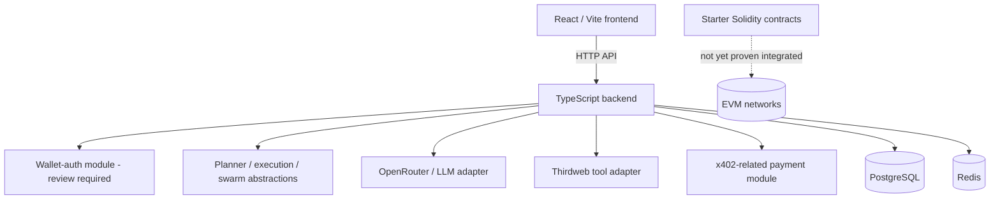
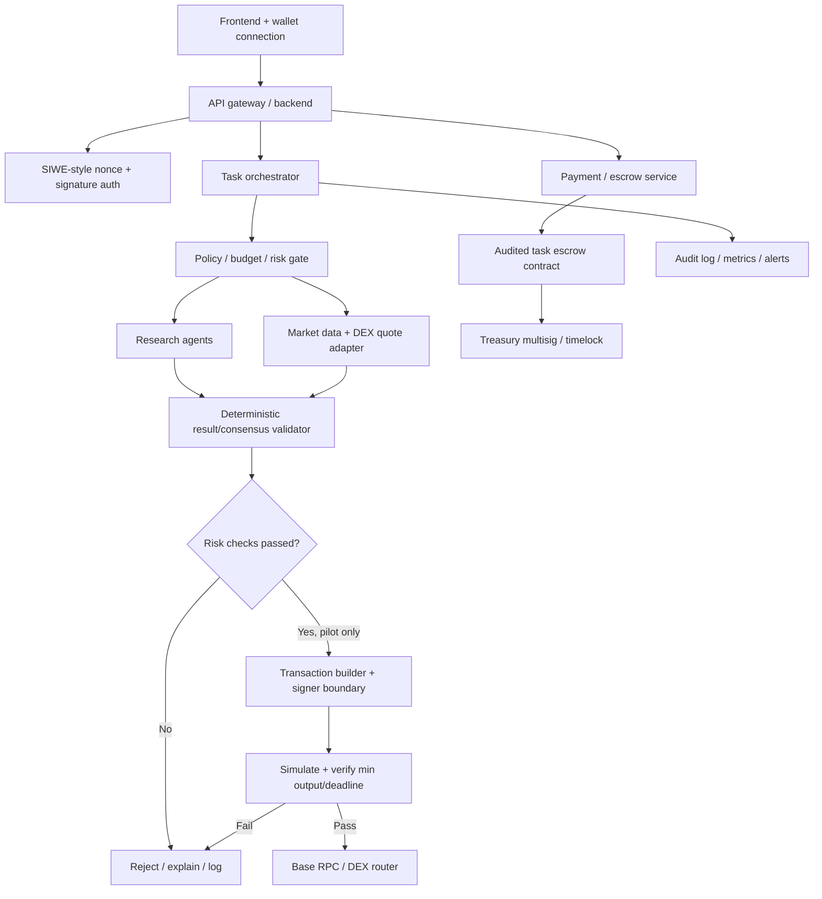

# OmniClaw architecture and detailed project structure

## Current system (repository-backed)



This diagram describes intended/module-level relationships, not a verified live deployment.

## Proposed target architecture



## Target repository structure

```text
omniclaw-ai/
├── README.md
├── .gitignore
├── .env.example                 # placeholders only; never real secrets
├── docker-compose.yml
├── package.json                 # frontend/root toolchain as currently configured
├── index.html
├── src/                         # primary Vite React app and UI components
├── frontend/                    # legacy/alternate frontend artifacts; consolidate deliberately
├── backend/
│   ├── .env.example             # backend-only placeholders
│   ├── package.json
│   ├── src/
│   │   ├── api/ routes/         # HTTP API
│   │   ├── auth/                # wallet auth; security review required
│   │   ├── agents/              # planner/execution/swarm components
│   │   ├── core/                # router, queue, network manager
│   │   ├── llm/                 # model provider adapters
│   │   ├── payments/            # x402 integration; not a substitute for escrow
│   │   ├── storage/             # database and Redis adapters
│   │   ├── tools/               # Thirdweb integration
│   │   └── wallet/              # wallet abstraction
│   └── tests/
├── contracts/
│   ├── AgentRegistry.sol        # starter registry
│   ├── OmniClawDAO.sol          # starter DAO contract
│   └── Treasury.sol             # starter native-ETH treasury
├── dao/                         # governance/skill registry starter contracts
├── blockchain/                  # provider/router abstractions
├── agents/ ai/ swarm/            # additional early abstractions
└── docs/
    ├── PROJECT_STATUS.md
    ├── ARCHITECTURE.md
    ├── ROADMAP.md
    ├── SECURITY.md
    ├── DEPLOYMENT.md
    ├── ENVIRONMENT.md
    ├── WHITEPAPER.md
    └── SWARM_DESIGN.md
```

The structure intentionally notes the existing parallel `src/`, `frontend/`, and `frontend/src/` areas. Consolidate them only after identifying the Vercel build root and validating routes/build output; avoid deleting legacy code blindly.

## Agent responsibilities (target)

- **Orchestrator:** validates task schema, idempotency key, budget, deadline, policy, and state transitions. It should not hold unrestricted signing authority.
- **Research agents:** gather market/on-chain data with source provenance; they do not sign transactions.
- **Quote agent:** requests current quotes from supported DEX APIs/contracts and records block/time, fee tier, price impact, and expiry.
- **Risk agent:** applies deterministic limits independent of LLM recommendations.
- **Executor:** builds/simulates an approved transaction and requests signing from a constrained signer.
- **Payment agent:** verifies payment status and invokes escrow lifecycle functions only when on-chain preconditions hold.
- **Treasury operator:** multisig-controlled withdrawals and transparent accounting; no arbitrary agent-controlled payout path.
- **Audit/monitor agent:** records task, model, quote, decision, transaction hash, gas, status, and operator intervention.

## Task lifecycle (target)

```mermaid
sequenceDiagram
  participant U as User
  participant API as API
  participant O as Orchestrator
  participant R as Risk gate
  participant E as Executor
  participant C as Chain / escrow
  U->>API: Submit signed task + idempotency key
  API->>O: Validate and enqueue
  O->>R: Policy, budget, quote, risk context
  R-->>O: Approve / reject with reason
  alt Approved
    O->>E: Build transaction proposal
    E->>C: Simulate / read state
    E-->>O: Proposal + simulation result
    O-->>U: Require explicit approval for pilot trades
    U->>API: Approve exact calldata/limits
    API->>C: Submit transaction through constrained signer
    C-->>API: Receipt / final status
  else Rejected
    O-->>U: Rejection reason; no transaction submitted
  end
```

LLMs may recommend or summarize; deterministic policy code must decide whether a transaction is permitted.