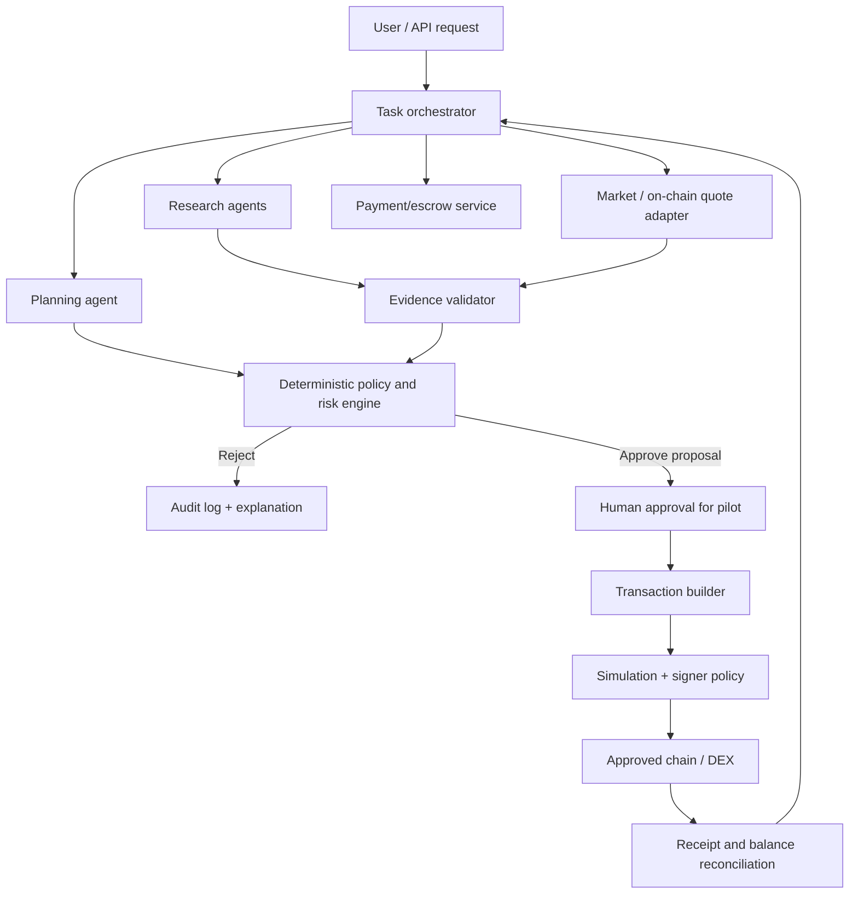

# OmniClaw multi-agent swarm design

**Status:** Proposed design. The existence of early agent/swarm modules in the repository does not mean the full swarm is implemented or production-tested.

## Topology

## Roles and permissions

| Role | May do | Must not do |
|---|---|---|
| Orchestrator | Validate task schema, coordinate work, update state | Bypass policy, hold unrestricted signing key |
| Planner | Propose steps and dependencies | Authorize spend or change policy |
| Research | Collect data and cite provenance | Submit transactions or invent unverified facts |
| Quote | Obtain route/price/liquidity data | Select arbitrary routers or override limits |
| Risk policy | Apply deterministic allow/deny rules | Delegate decisions to an LLM |
| Executor | Build/simulate a proposal under policy | Sign arbitrary calldata or expand budget |
| Payment | Verify payment and settlement preconditions | Release funds based only on a model-generated claim |
| Auditor/monitor | Record events, detect anomalies, alert operators | Mutate financial state without authorization |

## Consensus

A vote count can summarize independent agent opinions, but it is not a security control by itself. Before any execution, a deterministic gate must validate evidence freshness, asset/route allowlists, quote quality, spend limits, slippage, exposure, deadline, chain ID, and user authorization. The risk engine has a veto; a majority vote cannot override it.

## Message envelope

Use a versioned message format with `message_id`, `trace_id`, `task_id`, `sender`, `recipient`, `created_at`, `expires_at`, `schema_version`, `payload_hash`, and authorization metadata. Enforce sender/recipient permissions, schema validation, expiry, replay prevention, size limits, and signed provenance where needed. Treat free-form model text as untrusted data.

## Self-improvement boundary

The learning/evaluation agent may generate candidate prompt, routing, or strategy changes in a sandbox. It must not automatically modify production keys, transaction limits, allowlists, smart contracts, signer code, or governance permissions. Candidate changes need offline regression tests, adversarial tests, human review, staged rollout, monitoring, and rollback.

## Failure handling

- If an agent times out, retry only idempotent work and cap attempts.
- If sources disagree or quotes are stale, reject or request a refresh.
- If policy or simulation is unavailable, fail closed.
- If a transaction is submitted, track its nonce/hash and reconcile final receipt before any retry.
- If anomaly thresholds trip, disable signing and alert an operator.
- If an agent or provider is compromised, revoke its credentials and disable its capability without disabling unrelated read-only agents.

## Incremental rollout

1. Single orchestrator with mocked/read-only tools in local tests.
2. Research and quote agents in read-only mode with provenance checks.
3. Deterministic policy engine and simulation tests.
4. Testnet executor with explicit human approval.
5. Capped pilot after external security review.
6. Additional specialists, agent-to-agent payments, cross-chain tools, and DAO governance only after separate milestone reviews.